# FarmOrchestra — architektura docelowa

Dokument opisuje, **jak powinien być zbudowany kod gry**, żeby łatwo go rozbudowywać,
wymieniać jego części i testować jednostkowo. Nie opisuje stanu z gałęzi `grafika-3d`,
tylko stan docelowy. Gałąź `refaktor-architektura` przebudowuje kod zgodnie z tym dokumentem.

Diagramy są w Mermaid (GitHub i większość edytorów Markdown rysuje je same).

---

## Spis treści

1. [Ocena obecnego kodu](#1-ocena-obecnego-kodu)
2. [Zasady projektu](#2-zasady-projektu)
3. [Warstwy i reguła zależności](#3-warstwy-i-reguła-zależności)
4. [Struktura katalogów](#4-struktura-katalogów)
5. [Korzeń kompozycji i wstrzykiwanie zależności](#5-korzeń-kompozycji-i-wstrzykiwanie-zależności)
6. [Dane: definicje, konfiguracja, stan](#6-dane-definicje-konfiguracja-stan)
7. [Model maszyn](#7-model-maszyn)
8. [Systemy symulacji](#8-systemy-symulacji)
9. [Czysta logika (core)](#9-czysta-logika-core)
10. [Widoki i interfejs](#10-widoki-i-interfejs)
11. [Diagramy sekwencji](#11-diagramy-sekwencji)
12. [Diagramy stanów](#12-diagramy-stanów)
13. [Zapis gry i zgodność wersji](#13-zapis-gry-i-zgodność-wersji)
14. [Testy](#14-testy)
15. [Jak rozbudowywać grę](#15-jak-rozbudowywać-grę)
16. [Mapa migracji: stary plik → nowe miejsce](#16-mapa-migracji-stary-plik--nowe-miejsce)
17. [Konwencje kodu](#17-konwencje-kodu)
18. [Stan wdrożenia i weryfikacja](#18-stan-wdrożenia-i-weryfikacja)

---

## 1. Ocena obecnego kodu

Kod działa poprawnie i ma kilka dobrych decyzji, które architektura docelowa zachowuje:

- warstwa gry (fizyka 2D, zasady) jest oddzielona od widoków 2D/3D, które tylko czytają stan,
- maszyny i mapa są opisane w JSON (`machines.json`, `map.json`), więc nowa maszyna to głównie dane,
- część logiki już jest czysta i łatwa do testowania (`route_playback.gd`, `route_preview.gd`,
  `lot_planner.gd`, `machine_footprint.gd`, `grain_storage.gd`, `axle_groups.gd`),
- zapis jest atomowy (plik tymczasowy, kopia `.bak`), a format pola jest zwarty (`field_cells_v3`).

Problemy, które blokują rozbudowę i testy:

| Problem | Gdzie | Skutek |
|---|---|---|
| **Obiekt-bóg** `world.gd` (1250 linii) | tworzy symulację, maszyny, widoki, cały HUD, obsługuje klawisze, sklep, sen, zapis | każda nowa funkcja zmienia ten sam plik; nie da się uruchomić symulacji bez UI |
| Widoki i UI wołają świat przez `world.call("get_…")` | `view2d`, `view3d`, `ui` | brak jawnego kontraktu; literówka w nazwie metody wychodzi dopiero w grze |
| Kacze typowanie maszyn powielone w kilku miejscach | `_pose_node`, `_motion_body`, `_body_of`, `_change_mass` w `farm_services.gd`, `grain_transfer_system.gd`, `save_codec.gd`, `world.gd` | nowy typ maszyny wymaga poprawek w 4–5 plikach |
| Stan sterowania trasą w metadanych (`route_mode`, `route_system`) | `player_driver.gd`, `hitch_system.gd`, `route_system.gd` | ukryte zależności między systemami (`get_meta("route_system").release_hold(...)`) |
| Zasady gry wymieszane z węzłami i fizyką | `field_grid.gd` (zasady komórek + obraz), `field_work_system.gd` (zasady siewu/zbioru + geometria), `farm_services.gd`, `economy.gd` (czyta plik) | zasad nie da się przetestować bez sceny i plików |
| Systemy same czytają pliki konfiguracji | `farming.json` w FieldWork, `routes.json` w RouteSystem, `prices.json` w PriceList | testy nie mogą podać własnych ustawień |
| Brak zdarzeń domenowych | komunikaty płyną sygnałami różnych systemów wprost do `world.gd` | każdy nowy odbiorca wymaga zmian w świecie |
| Brak testów w repozytorium | — | regresje wykrywane ręcznie |

---

## 2. Zasady projektu

1. **Reguła zależności**: warstwy zależą tylko „w dół” (rozdział 3). Czysta logika nie zna Godota poza typami
   matematycznymi (`Vector2`, `Transform2D`, `PackedByteArray`).
2. **Jedna odpowiedzialność**: plik ma jeden powód do zmiany. Budowa HUD-u, obsługa klawiszy, sklep i sen
   to osobne klasy.
3. **Jawne zależności (DI)**: obiekt dostaje to, czego potrzebuje, w `setup(...)`/`configure(...)`
   (przez `GameContext`), a nie szuka tego w drzewie sceny ani w metadanych.
4. **Dane sterują grą**: nowa maszyna, punkt na mapie albo cena to zmiana w JSON; kod zmienia się tylko
   przy nowym *rodzaju* zachowania (nowy `physics_kind`, nowa operacja pracy).
5. **Polecenia i zapytania osobno (CQS)**: widoki i UI czytają stan przez `WorldQuery`,
   zmieniają go wyłącznie przez `GameActions`. Zdarzenia płyną przez `EventBus`.
6. **Testowalność**: każda zasada gry ma test jednostkowy bez sceny; każdy system ma test integracyjny
   na prawdziwej fizyce (headless).
7. **Zgodność zapisu**: refaktor nie zmienia formatu zapisu ani tras; stare zapisy dalej się wczytują.

---

## 3. Warstwy i reguła zależności

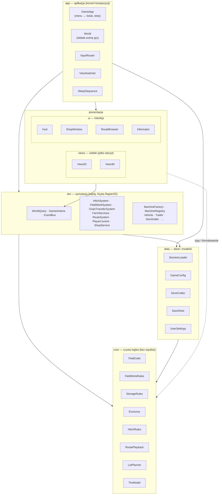

| Warstwa | Może zależeć od | Nie może zależeć od | Rodzaj klas |
|---|---|---|---|
| `core` | nic (tylko typy wbudowane Godota) | węzłów, plików, sceny | `RefCounted`, funkcje statyczne |
| `data` | `core` | `sim`, widoków, UI | `RefCounted`; jedyne miejsce z `FileAccess`/`ConfigFile` (poza ustawieniami ekranu) |
| `sim` | `core`, `data` | widoków, UI, `app` | `Node2D`/`RigidBody2D`, systemy |
| `views` | `WorldQuery`, `EventBus`, protokół maszyn `sim/machines/machines.gd` (odczyt), `core` | `GameActions`, systemów | `Node2D`/`Node3D` |
| `ui` | `WorldQuery`, `GameActions`, `EventBus`, protokół maszyn, `core`, `views` (gotowe rysowanie podglądów: maszyna 3D w sklepie, sylwetki na minimapie) | wnętrza systemów | `Control` |
| `app` | wszystko | — | składanie całości |

Sprawdzenie reguły jest automatyczne: test `tests/unit/test_layers.gd` czyta pliki `.gd`
i sprawdza, że `preload(...)` w danej warstwie wskazuje tylko na warstwy dozwolone, że `core`
nie tworzy węzłów i nie czyta plików, a widoki i UI nie wołają świata ani pól prywatnych maszyn.
`WorldQuery`, `GameActions` i `EventBus` trafiają do prezentacji jako obiekty (wstrzyknięte),
więc nie wymagają `preload` po stronie widoków.

---

## 4. Struktura katalogów

```text
scripts/
├── app/                      aplikacja, korzeń kompozycji
│   ├── game_app.gd           menu ↔ świat, zapis slotu, czas gry
│   ├── start_menu.gd         menu startowe (karty slotów)
│   ├── world.gd              składa symulację, widoki i HUD; sygnały do GameApp
│   ├── input_router.gd       klawisze → GameActions (tabela akcji)
│   ├── view_switcher.gd      widok 2D/3D, zapamiętanie trybu
│   ├── sleep_sequence.gd     sen: zasłona + wzrost roślin w ciemności
│   └── display_settings.gd   pełny ekran / okno (F11)
├── core/                     czysta logika – testy jednostkowe
│   ├── util/                 vec.gd, time_format.gd
│   ├── machines/             axle_groups.gd, tire_model.gd
│   ├── field/                field_cells.gd, field_work_rules.gd
│   ├── storage/              storage_rules.gd
│   ├── transfer/             pipe_motion.gd, unload_rules.gd
│   ├── services/             fill_rules.gd
│   ├── economy/              price_list.gd, economy.gd
│   ├── hitch/                hitch_rules.gd
│   ├── routes/               route_data.gd, route_sample.gd, route_playback.gd,
│   │                         route_preview.gd, route_signature.gd, route_recorder.gd
│   └── shop/                 lot_planner.gd, machine_footprint.gd, instance_factory.gd
├── data/                     wejście/wyjście
│   ├── json_file.gd          odczyt obiektu JSON z błędem
│   ├── game_config.gd        farming.json, routes.json, prices.json (katalog do podmiany w testach)
│   ├── session_loader.gd     save.json + map.json + machines.json → sesja (walidacja odwołań)
│   ├── save_codec.gd         stan świata ↔ dokument zapisu (walidacja, migracje)
│   ├── save_slots.gd         3 sloty, plik tymczasowy, kopia .bak
│   └── user_settings.gd      user://settings.cfg (tryb widoku, pełny ekran)
├── sim/                      symulacja
│   ├── game_context.gd       kontener zależności (DI)
│   ├── event_bus.gd          zdarzenia domenowe
│   ├── simulation_builder.gd buduje drzewo symulacji z sesji
│   ├── world_query.gd        odczyt dla widoków i UI
│   ├── game_actions.gd       polecenia gracza
│   ├── player_control.gd     sterowany pojazd, przełączanie (TAB), komunikaty dla gracza
│   ├── machines/             protokół i fabryka maszyn + fizyka maszyn
│   │   ├── machines.gd             statyczny dostęp do protokołu maszyny
│   │   ├── machine_factory.gd      physics_kind → skrypt (rejestr)
│   │   ├── machine_registry.gd     maszyny w grze (id → węzeł)
│   │   ├── vehicle.gd, trailer.gd, single_axle_implement.gd, semitrailer.gd,
│   │   │   semitrailer_body.gd, mounted_implement.gd, parked_machine.gd
│   │   ├── passive_axle_body.gd, tires.gd, collision_levels.gd
│   │   └── unloading_pipe.gd
│   ├── systems/              hitch_system.gd, field_work_system.gd, field_grid.gd,
│   │                         grain_transfer_system.gd, farm_services.gd,
│   │                         static_obstacles.gd, player_driver.gd, shop_service.gd
│   └── routes/               route_system.gd, route_rig.gd, route_collision.gd
├── views/
│   ├── view2d/               widok z góry
│   └── view3d/               widok low-poly
└── ui/
    ├── hud/                  hud.gd (pasek akcji, kolumna tras) + hud_style, money_panel, toast,
    │                         debug_panel, context_actions, seed_crop_selector, sleep_curtain
    ├── info/                 dostawcy informatora
    ├── routes/               okno tras, nagrywanie, minimapa
    └── informator.gd, shop_window.gd, machine_preview.gd, fill_dialog.gd, icon_button.gd
tests/
├── run_tests.gd              runner (godot --headless -s tests/run_tests.gd)
├── framework/                test_case.gd, sim_harness.gd
├── unit/                     core/ (logika), data/ (konfiguracja, zapis), test_layers.gd
└── integration/              maszyny i zaczepy, praca na polu, przepływ ziarna, sklep i zapis,
                              trasy, dymny test pełnego świata
```

---

## 5. Korzeń kompozycji i wstrzykiwanie zależności

Obiekty nie szukają zależności same. Tworzy je **jedno miejsce** – `SimulationBuilder`
(symulacja) i `World` (widoki, HUD, wejście) – i podaje je przez `setup(context)`.
`GameContext` to prosty kontener: pola z gotowymi usługami. Testy budują go tak samo
(albo częściowo, z danymi testowymi).

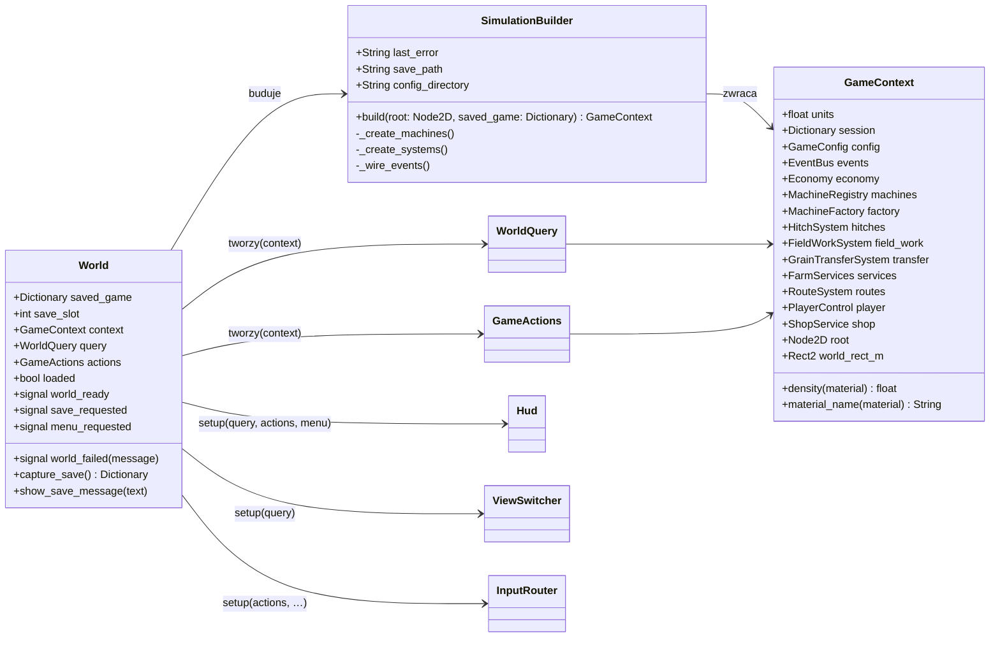

Kolejność budowy (każdy krok może się nie udać — wtedy `last_error` i `world_failed`):

1. `SessionLoader.load_session("res://files/save.json")` – szablon nowej gry, mapa, katalog maszyn.
2. `SaveCodec.prepare_session(session, saved_game)` – zapis gracza (albo szablon) po walidacji.
3. `GameConfig.load_from(dir)` – `farming.json`, `routes.json`, `prices.json`.
4. `Economy`, `StaticObstacles`, `MachineFactory` + `MachineRegistry` (maszyny), `PlayerControl`.
5. Systemy: `HitchSystem` (odtworzenie połączeń) → `FieldWorkSystem` → `GrainTransferSystem`
   → `FarmServices` → `RouteSystem` → `ShopService`.
6. Połączenie zdarzeń (`EventBus`).

---

## 6. Dane: definicje, konfiguracja, stan

Trzy rodzaje danych, każdy z własnym właścicielem:

| Rodzaj | Plik | Kto czyta | Zmienność |
|---|---|---|---|
| **Definicje** (co istnieje) | `machines.json` (modele, materiały, zasady zaczepów), `map.json` (pola, punkty farmy, przeszkody, sklep) | `SessionLoader` | tylko przy tworzeniu gry |
| **Konfiguracja** (jak działa) | `farming.json`, `routes.json`, `prices.json` | `GameConfig` | stała w trakcie gry |
| **Stan** (co się dzieje) | slot zapisu (`user://saves/slot_N.json`), szablon `save.json` | `SaveCodec`, `SaveSlots` | zmienia się co krok |

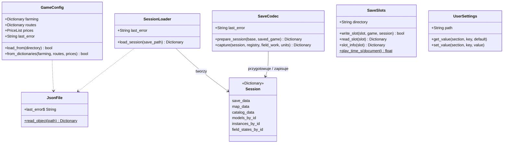

**Stan maszyny** (`instance_state`) jest jednym słownikiem współdzielonym przez wszystkie systemy
i zapis gry: `transform`, `motion`, `storages`, `work_state`, `fold_state`, `seed_crop_id`,
`unloading_state`, `articulated_state`. Każdy system zmienia tylko swoje klucze
(tabela w rozdziale 8). Dzięki temu zapis nie potrzebuje kodu dla każdego systemu.

---

## 7. Model maszyn

### 7.1 Protokół maszyny

GDScript nie ma interfejsów, a maszyny dziedziczą po różnych klasach Godota (`RigidBody2D`
dla pojazdu, `Node2D` dla zestawów kilku ciał). Dlatego **protokół** jest zbiorem metod, które
ma każdy węzeł maszyny. `MachineFactory` sprawdza go przy rejestracji typu, a test
`test_machine_protocol.gd` – dla każdego `physics_kind`. Reszta gry używa wyłącznie protokołu
(przez `Machines`), nigdy pól prywatnych (`_ground_body`, `_carrier`).

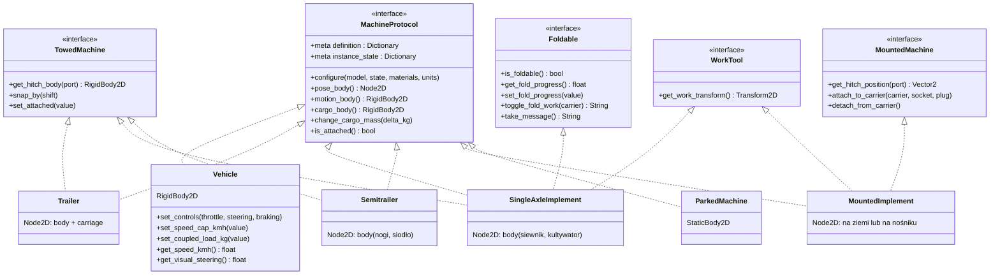

`Machines` (statyczny) to jedyne miejsce z „kaczym” dostępem:

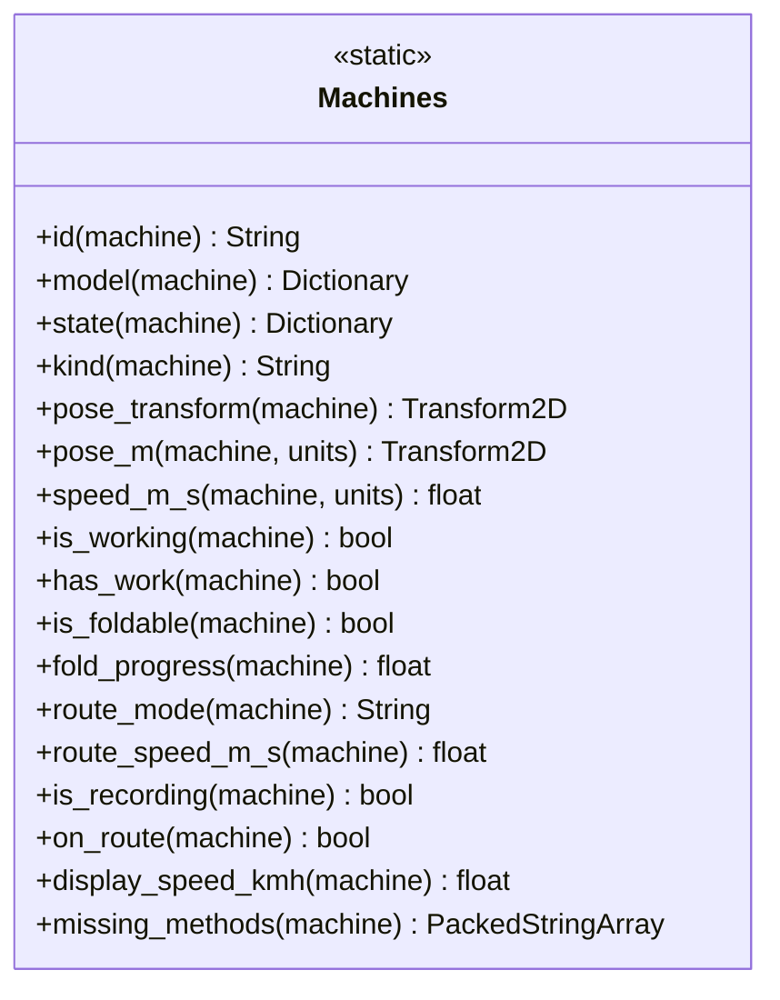

### 7.2 Fabryka i rejestr

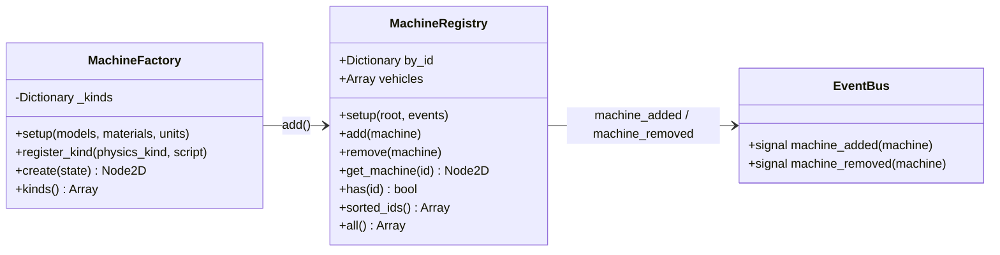

Domyślne rodzaje (`physics_kind` z `machines.json`):

| `physics_kind` | Skrypt | Ciała | Zaczep |
|---|---|---|---|
| `powered_vehicle` | `vehicle.gd` | 1 `RigidBody2D` (+ ciała poziomów kolizji) | gniazda (`socket`) |
| `towed_turntable` | `trailer.gd` | nadwozie + wózek skrętny | `drawbar` na wózku |
| `towed_single_axle` | `single_axle_implement.gd` | nadwozie z dyszlem | `drawbar` |
| `towed_semitrailer` | `semitrailer.gd` | nadwozie (nogi, sworzeń) | `fifth_wheel` |
| `rigid_mounted` | `mounted_implement.gd` | na ziemi: statyczne/dynamiczne, podpięte: część nośnika | `combine_header`, `three_point` |
| *(inny)* | `parked_machine.gd` | `StaticBody2D` | — |

Nowy rodzaj fizyki = nowy skrypt spełniający protokół + `factory.register_kind(...)` w jednym miejscu.

### 7.3 Kolizje na dwóch poziomach

`CollisionLevels` (bez zmian funkcjonalnych): bryły z `levels: ["low"]` / `["high"]` trafiają na
lekkie ciała poziomów zespawane stawem stałym z nadwoziem. `Machines.pose_transform` zawsze
zwraca nadwozie główne, a `RouteRig` zbiera także ciała poziomów.

---

## 8. Systemy symulacji

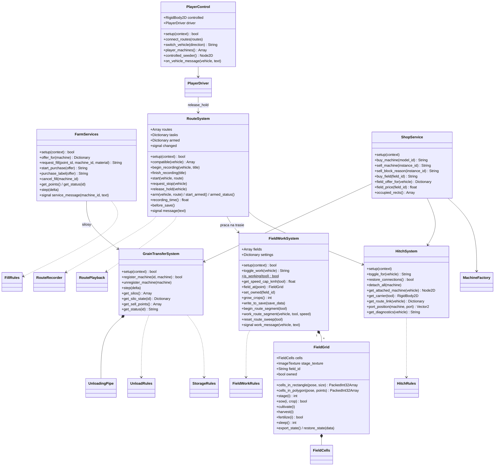

### 8.1 Kto zmienia które klucze stanu

| Klucz `instance_state` / `save_data` | Właściciel (zapis) | Czytelnicy |
|---|---|---|
| `transform`, `motion` | skrypt maszyny (co krok fizyki) | `SaveCodec`, widoki |
| `storages` | `FieldWorkSystem` (siew, nawóz, zbiór), `GrainTransferSystem`, `FarmServices` | informator, widoki (poziom ziarna) |
| `work_state` | `FieldWorkSystem.toggle_work`, maszyna składana, `RouteRig` (odtwarzanie) | widoki (animacje), informator |
| `fold_state` | `SingleAxleImplement` | zapis |
| `seed_crop_id` | `GameActions.cycle_seed_crop` (przez `FieldWorkRules`) | siew |
| `unloading_state` | `GrainTransferSystem`, `UnloadingPipe` | widoki (strumień ziarna) |
| `save_data.connections` | `HitchSystem` | `SaveCodec` |
| `save_data.economy` | `Economy` | menu (karta slotu) |
| `save_data.owned_fields` | `FieldWorkSystem.set_owned` | — |
| `save_data.recorded_routes` | `RouteSystem` | okno tras |
| `save_data.unload_point_states` | `GrainTransferSystem` | widoki silosów |
| `save_data.player` | `PlayerControl` | zapis |

### 8.2 Kolejność w kroku fizyki

`process_physics_priority` ustala kolejność niezależnie od miejsca w drzewie:

| Priorytet | Węzeł | Co robi |
|---|---|---|
| −20 | `RouteSystem` | nagrywa próbkę, planuje krok odtwarzania, ustawia pozy zestawów na trasie |
| −10 | `PlayerDriver` | klawisze → `set_controls` sterowanego pojazdu |
| 0 | maszyny | stan do `instance_state`, składanie, profile kolizji |
| 0 | `FieldWorkSystem` | limit prędkości od narzędzia, praca na polu (gdy nie na trasie) |
| 0 | `GrainTransferSystem` | wywrotki/naczepy, potem rury |
| 0 | `FarmServices` | napełnianie z silosu i magazynu |
| — | Rapier2D | `_integrate_forces` maszyn (opony, napęd), całkowanie |

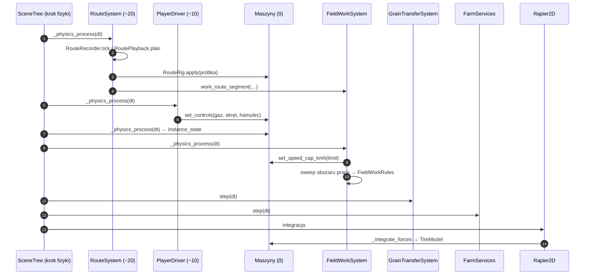

---

## 9. Czysta logika (core)

Wszystko poniżej to `RefCounted` albo funkcje statyczne. Nie tworzą węzłów, nie czytają plików,
nie pytają drzewa sceny. Testy jednostkowe uruchamiają je bez świata gry.

```mermaid
classDiagram
    direction TB
    class FieldCells {
        +enum Stage PLAIN SOWN LIGHT DARK READY HARVESTED
        +CROP_IDS
        +int columns
        +int rows
        +PackedByteArray states
        +PackedByteArray crop_codes
        +PackedByteArray fertilized
        +PackedInt32Array block_counts
        +int blocks_revision
        +setup(columns, rows)
        +stage(i) int
        +crop_at(i) String
        +fertilizer_level(i) int
        +sow(i, crop) bool
        +cultivate(i) bool
        +harvest(i) bool
        +fertilize(i) bool
        +grow() PackedInt32Array
        +fill_strips(crops, stage)
        +plants_in_blocks(from, to) int
        +export_state() Dictionary
        +restore_state(data) bool
        +unpack_cells(data, count)$ PackedByteArray
    }
    class FieldWorkRules {
        <<static>>
        +is_working(state) bool
        +speed_cap_kmh(model, working) float
        +work_allowed(operation, speed, minimum) bool
        +toggle_message(model, active) String
        +seed_crop(model, state) String
        +next_seed_crop(model, state) String
        +sow_check(stage, storage, crop, cost) Dictionary
        +fertilize_check(storage, dose) Dictionary
        +consume(storage, amount, clear_material)
        +harvest_yield(settings, crop, fert_level, area) float
        +harvest_check(...) Dictionary
        +store_harvest(storage, def, material, amount)
    }
    class StorageRules {
        <<static>>
        +storage_definition(model, id) Dictionary
        +space_for(storage, def, material) float
        +silo_space(state, def, material) float
        +silo_total(state) float
        +transfer(source, target, def, limit, to_silo) float
        +rectangle(pose, area, units) PackedVector2Array
    }
    class UnloadRules {
        <<static>>
        +delay_step(state, zone_id, delay, delta) float
        +leave_zone(state)
        +limit_l(mode, rate, usable) float
        +status(mode, target_kind, moved, delta) String
    }
    class PipeMotion {
        +float extension
        +float idle_seconds
        +setup(config, saved_state)
        +advance(want_open, delta) float
        +write(saved_state)
    }
    class FillRules {
        <<static>>
        +option_state(storage, def, material, inside_name) Dictionary
        +purchase_amount(rate, delta, room, money, price) float
        +purchase_label(material) String
    }
    class PriceList {
        +setup(data) bool
        +grain_sell_price(material) float
        +supply_buy_price(material) float
        +machine_price(model) float
        +machine_resale_price(model) float
        +field_price(field) float
        +format(amount) String
    }
    class Economy {
        +PriceList prices
        +configure(save_data, prices) bool
        +get_money() float
        +can_afford(amount) bool
        +earn(amount, reason)
        +spend(amount, reason) bool
        +signal money_changed
    }
    class HitchRules {
        <<static>>
        +ports_match(socket, plug) bool
        +link_kind(port_type) String
        +required_methods(port_type) Array
        +attach_distance(policy, socket, plug) float
        +distance_problem(distance, allowed) String
        +angle_problem(socket, parent_rot, child_rot) String
        +nearest(candidates) Dictionary
    }
    class RouteData {
        <<static>>
        +VERSION
        +valid(route) bool
        +at(route, time, hint) Dictionary
        +between(route, start, finish, hint) Array
    }
    class RouteSample {
        <<static>>
        +interpolate(a, b, time) Array
    }
    class RoutePlayback {
        +setup(route, settings)
        +plan(dt) Dictionary
        +commit(step)
        +halt()
        +begin_stop()
        +setup_blend(actual, min_length)
        +blended(point) Array
    }
    class RouteRecorder {
        +Array samples
        +float time
        +start(point, sample_seconds)
        +advance(delta) float
        +record(point, moving)
        +append(point)
        +finish(point) bool
    }
    class RouteSignature {
        <<static>>
        +build(vehicle_model, tool_model, socket, plug) Dictionary
        +matches(signature, vehicle_model, tool_model, socket, plug) bool
    }
    class RoutePreview
    class LotPlanner {
        <<static>>
        +find_spot(lot, footprint, occupied, spacing)
    }
    class MachineFootprint {
        <<static>>
        +local_rect(model) Rect2
        +world_aabb(local, position, rotation) Rect2
    }
    class InstanceFactory {
        <<static>>
        +new_state(model, id, position, rotation) Dictionary
        +next_id(prefix, taken) String
        +prefix_for(model) String
    }
    class TireModel {
        <<static>>
        +wheel_force(body, offset, angle, load, drive, brake, rr, grip, response, wheels, units) Vector2
    }
    class AxleGroups {
        <<static>>
        +physical(axles) Array
    }
    class TimeFormat {
        <<static>>
        +play_time(seconds) String
    }
    Economy *-- PriceList
    RoutePlayback ..> RouteData
    RouteData ..> RouteSample
    RoutePreview ..> RouteData
```

---

## 10. Widoki i interfejs

### 10.1 Fasada dla prezentacji

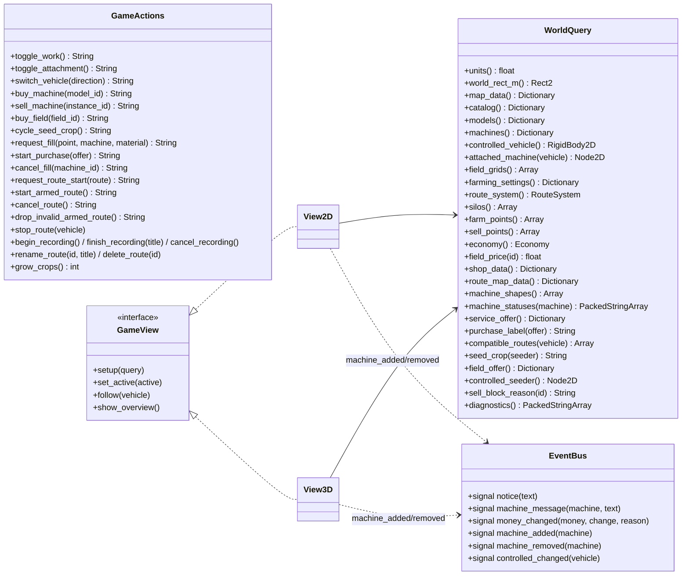

Zasady:

- **Widoki** dostają tylko `WorldQuery` (a przez `query.events()` – `EventBus`). Nie mają dostępu do `GameActions`, więc nie mogą
  zmienić gry. Nowa maszyna (zakup) pojawia się w widoku przez `machine_added`, nie przez wołanie widoku przez świat.
- **UI** dostaje `WorldQuery`, `GameActions` i `EventBus`. Każda zmiana gry przechodzi przez `GameActions`.
- `GameActions` zwraca tekst komunikatu; wołający decyduje, gdzie go pokazać (dymek, etykieta w oknie sklepu).

### 10.2 HUD złożony z małych kontrolek

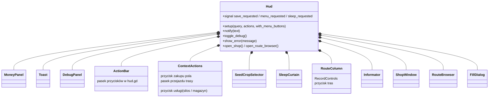

`InputRouter` mapuje klawisze na akcje (tabela w jednym miejscu):

| Klawisz | Akcja |
|---|---|
| F9 / Esc | `world.save_requested` / `world.menu_requested` |
| Home / F | widok: przegląd / śledzenie pojazdu |
| B | `actions.toggle_work()` |
| E | `actions.toggle_attachment()` (odroczone poza krok fizyki) |
| R / K | okno tras / sklep |
| N | `SleepSequence.start()` |
| V | `ViewSwitcher.toggle()` |
| F3 | panel diagnostyczny |
| TAB / Shift+TAB | `actions.switch_vehicle(±1)` |

---

## 11. Diagramy sekwencji

### 11.1 Start gry z menu

```mermaid
sequenceDiagram
    autonumber
    actor Gracz
    participant Menu as StartMenu
    participant App as GameApp
    participant Slots as SaveSlots
    participant W as World
    participant B as SimulationBuilder
    participant H as Hud
    Gracz->>Menu: „Wczytaj” (slot 2)
    Menu->>App: start_requested(2, false)
    App->>Slots: read_slot(2)
    Slots-->>App: dokument (game, session.play_time_s)
    App->>W: new(); saved_game = game
    App->>W: add_child → _ready()
    W->>B: build(root, saved_game)
    B->>B: SessionLoader → SaveCodec.prepare_session → GameConfig
    B->>B: Economy, przeszkody, maszyny, systemy, zdarzenia
    B-->>W: GameContext
    W->>W: WorldQuery, GameActions, ViewSwitcher(2D, 3D)
    W->>H: setup(query, actions, menu)
    W-->>App: world_ready
```

### 11.2 Podpięcie narzędzia (E)

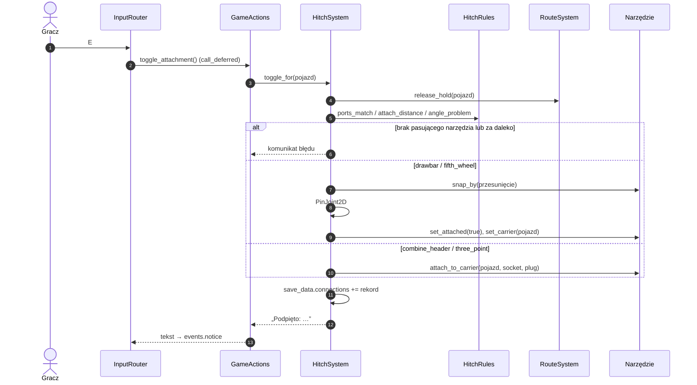

### 11.3 Praca na polu (krok fizyki)

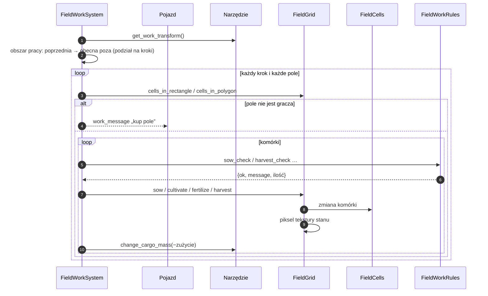

### 11.4 Rozładunek przyczepy nad kratą lub skupem

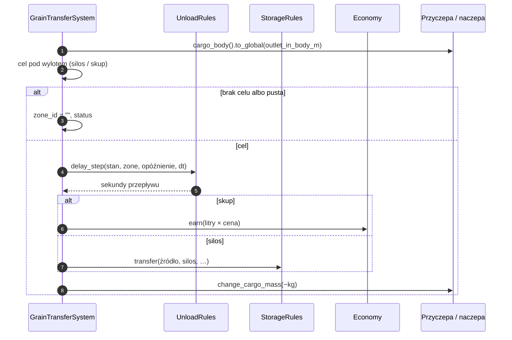

### 11.5 Zakup w magazynie przy wiacie

```mermaid
sequenceDiagram
    autonumber
    actor Gracz
    participant CA as ContextActions
    participant Q as WorldQuery
    participant GA as GameActions
    participant FS as FarmServices
    participant FR as FillRules
    participant E as Economy
    CA->>Q: service_offer()
    Q->>FS: offer_for(maszyna gracza)
    FS->>FR: option_state(...)
    FS-->>CA: oferta „Kup nawóz”
    Gracz->>CA: klik
    CA->>GA: start_purchase(oferta)
    GA->>FS: request_fill(punkt, maszyna, materiał)
    loop każdy krok fizyki, aż pełne / brak pieniędzy
        FS->>FR: purchase_amount(wydajność, dt, miejsce, pieniądze, cena)
        FS->>E: spend(litry × cena)
        FS->>FS: storage += litry; change_cargo_mass
    end
    FS-->>GA: service_message → events.machine_message
```

### 11.6 Kupno maszyny w sklepie

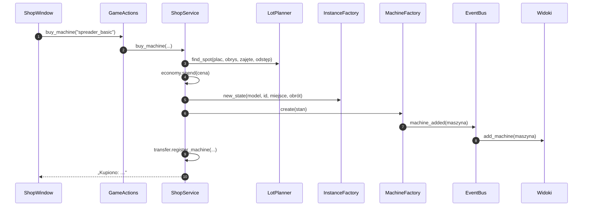

### 11.7 Nagrywanie i odtwarzanie trasy

```mermaid
sequenceDiagram
    autonumber
    actor Gracz
    participant RC as RecordControls
    participant GA as GameActions
    participant RS as RouteSystem
    participant RR as RouteRecorder
    participant PB as RoutePlayback
    participant Rig as RouteRig
    participant FW as FieldWorkSystem
    Gracz->>RC: nagrywaj
    RC->>GA: begin_recording()
    GA->>RS: begin_recording(pojazd, "")
    RS->>RR: start(próbka 0)
    loop krok fizyki
        RS->>RR: advance(dt)
        RS->>Rig: sample(t)
        RS->>RR: record(próbka, ruch)
    end
    Gracz->>RC: stop + nazwa
    RC->>GA: finish_recording(nazwa)
    RS->>RR: finish(próbka końcowa)
    RS->>RS: routes += trasa (sygnatura RouteSignature)
    Note over Gracz,RS: odtwarzanie
    Gracz->>GA: request_route_start(trasa)
    GA->>RS: arm(pojazd, trasa) / armed_status()
    GA->>RS: start_armed() (na miejscu, narzędzie OK, < 6 km/h)
    RS->>PB: setup + setup_blend(rzeczywista poza)
    RS->>Rig: lock(); apply(poza startowa)
    loop krok fizyki
        RS->>PB: plan(dt)
        RS->>RS: RouteCollision: wolne miejsce?
        RS->>Rig: apply(próbki odcinka)
        RS->>FW: work_route_segment(...)
        RS->>PB: commit(krok)
    end
    RS->>Rig: koniec → held; W/S/A/D → release_hold
```

### 11.8 Zapis gry (F9)

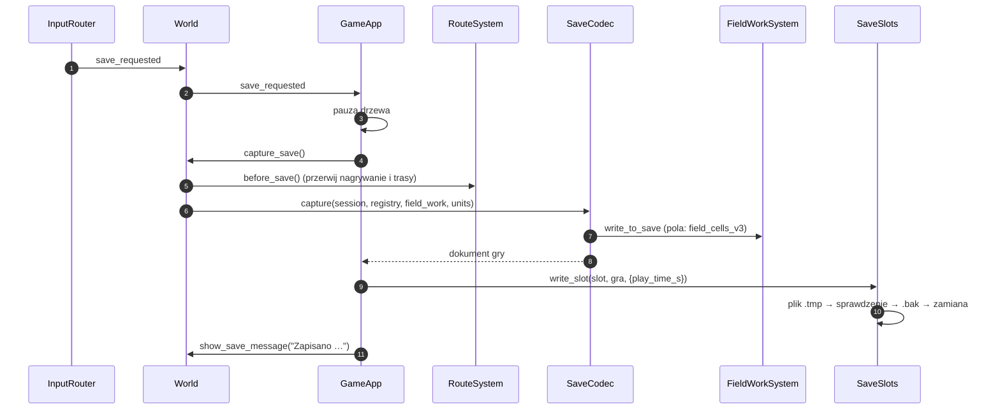

### 11.9 Sen (N)

```mermaid
sequenceDiagram
    autonumber
    participant IR as InputRouter
    participant SQ as SleepSequence
    participant SC as SleepCurtain
    participant GA as GameActions
    participant FW as FieldWorkSystem
    IR->>SQ: start()
    SQ->>SQ: get_tree().paused = true
    SQ->>SC: ściemnij (1,6 s)
    SQ->>GA: grow_crops()
    GA->>FW: grow_crops() → FieldGrid.sleep() → FieldCells.grow()
    SQ->>SC: przerwa 0,5 s, rozjaśnij (1,9 s)
    SQ->>SQ: paused = false; komunikat
```

---

## 12. Diagramy stanów

### 12.1 Komórka pola

```mermaid
stateDiagram-v2
    [*] --> PLAIN
    PLAIN --> SOWN : siew (ziarno w siewniku)
    SOWN --> LIGHT : sen
    LIGHT --> DARK : sen
    DARK --> READY : sen
    READY --> HARVESTED : zbiór (heder, zbiornik ma miejsce)
    SOWN --> PLAIN : kultywacja
    LIGHT --> PLAIN : kultywacja
    DARK --> PLAIN : kultywacja
    READY --> PLAIN : kultywacja
    HARVESTED --> PLAIN : kultywacja
```

### 12.2 Nawożenie komórki (bity `fertilized`)

```mermaid
stateDiagram-v2
    [*] --> Brak
    Brak --> PrzedSiewem : nawóz na PLAIN/HARVESTED (FERT_BEFORE)
    Brak --> WTrakcie : nawóz na SOWN..DARK (FERT_GROWING)
    PrzedSiewem --> Oba : nawóz na SOWN..DARK
    WTrakcie --> Oba : nawóz na PLAIN/HARVESTED (po kultywacji)
    PrzedSiewem --> Brak : zbiór
    WTrakcie --> Brak : zbiór
    Oba --> Brak : zbiór
    note right of Oba : poziom 2 → premia plonu 35 %
```

### 12.3 Narzędzie składane (kultywator)

```mermaid
stateDiagram-v2
    [*] --> Zlozony
    Zlozony --> SprawdzanieMiejsca : B
    SprawdzanieMiejsca --> Zlozony : przeszkoda pod skrzydłem
    SprawdzanieMiejsca --> Rozkladanie : miejsce wolne
    Rozkladanie --> Skladanie : B albo przeszkoda
    Rozkladanie --> Pracuje : fold = 1 (opuszczony)
    Pracuje --> Skladanie : B (podnieś)
    Skladanie --> Zlozony : fold = 0
    Pracuje --> Zlozony : odpięcie (praca wyłączona)
```

### 12.4 Zadanie trasy pojazdu

```mermaid
stateDiagram-v2
    [*] --> Reczne
    Reczne --> Nagrywanie : begin_recording (< 6 km/h, narzędzie nie w ruchu)
    Nagrywanie --> Reczne : finish / cancel
    Reczne --> Uzbrojona : arm(trasa) (zestaw widmo)
    Uzbrojona --> Reczne : odwołaj
    Uzbrojona --> Jedzie : start_armed (na miejscu, narzędzie OK, < 6 km/h)
    Jedzie --> Pauza : przeszkoda
    Pauza --> Jedzie : miejsce wolne przez resume_clear_seconds
    Jedzie --> Zwalnia : request_stop
    Zwalnia --> Trzymany : prędkość 0
    Pauza --> Trzymany : request_stop
    Jedzie --> Trzymany : koniec trasy / zapis gry
    Trzymany --> Reczne : W/S/A/D albo E
```

### 12.5 Rozładunek (wywrotka / taśmociąg)

```mermaid
stateDiagram-v2
    [*] --> PozaMiejscem
    PozaMiejscem --> Odliczanie : wylot nad silosem/skupem
    Odliczanie --> PozaMiejscem : wyjazd
    Odliczanie --> Wysyp : start_delay_seconds minęło
    Wysyp --> PozaMiejscem : wyjazd
    Wysyp --> Pusta : ładunek = 0
    Pusta --> [*]
    note right of Wysyp : tipper – cały ładunek w jednym kroku\nconveyor – max_transfer_l_per_s
```

### 12.6 Rura kombajnu

```mermaid
stateDiagram-v2
    [*] --> Zlozona
    Zlozona --> Rozkladanie : zbiornik pełny albo odbiornik w zasięgu
    Rozkladanie --> Otwarta : extension = 1
    Otwarta --> Przeladunek : końcówka nad odbiornikiem
    Przeladunek --> Otwarta : odbiornik pełny / odjechał
    Otwarta --> Zwloka : brak powodu
    Zwloka --> Skladanie : close_delay_seconds
    Skladanie --> Zlozona : extension = 0
```

### 12.7 Aplikacja

```mermaid
stateDiagram-v2
    [*] --> Menu
    Menu --> Wczytywanie : nowa gra / wczytaj
    Wczytywanie --> Gra : world_ready
    Wczytywanie --> Menu : world_failed
    Gra --> Zapis : F9
    Zapis --> Gra : OK albo błąd (okno)
    Gra --> Sen : N
    Sen --> Gra : świt
    Gra --> Sklep : K (pauza)
    Sklep --> Gra : Esc
    Gra --> Menu : Esc (zapis + powrót)
```

---

## 13. Zapis gry i zgodność wersji

- Dokument slotu: `{"format_version": 1, "slot", "saved_at_utc", "session": {"play_time_s"}, "game": {...}}`.
- `game` = `save_data` z sesji po `SaveCodec.capture` (maszyny bez `motion`, pola w `field_cells_v3`).
- `SaveCodec.prepare_session` jest **jedynym** miejscem migracji: stare materiały siewne → `seed`,
  pola v2 → v3, nowe pola mapy dodawane jako puste, pola o zmienionym rozmiarze zerowane.
- Trasy: `RouteData.VERSION` (obecnie 4) i `RouteSignature.matches` przyjmujące starszą sygnaturę.
- Każda zmiana formatu = nowa wersja + migracja + test jednostkowy migracji (`tests/unit/test_save_codec.gd`).

---

## 14. Testy

### 14.1 Piramida

```mermaid
flowchart TB
    E2E["Dymny test pełnego świata\n(World + widoki + HUD, headless)"]
    INT["Testy integracyjne symulacji\n(SimulationBuilder, prawdziwa fizyka Rapier2D)"]
    UNIT["Testy jednostkowe\n(core + data, bez sceny)"]
    E2E --- INT --- UNIT
    style UNIT fill:#cfe8c4
    style INT fill:#f6e2a8
    style E2E fill:#f3c4b5
```

| Poziom | Co sprawdza | Czas | Przykłady |
|---|---|---|---|
| jednostkowe | zasady gry i dane | ms | `FieldCells` (fazy, nawożenie, pakowanie v3), `FieldWorkRules`, `StorageRules`, `Economy`, `PriceList`, `HitchRules`, `RoutePlayback` (rampy, hamowanie, wejście na trasę), `RouteRecorder`, `RouteSignature`, `LotPlanner`, `MachineFootprint`, `InstanceFactory`, `TireModel`, `AxleGroups`, `SaveCodec` (walidacja, migracje), `SaveSlots` (katalog tymczasowy), `SessionLoader`, `GameConfig`, warstwy |
| integracyjne | systemy na prawdziwej fizyce | s | jazda, podpięcie każdego typu zaczepu, kultywacja/siew/zbiór, rura kombajnu, wywrotka i skup, silos, magazyn, sklep, sen, zapis → odczyt, trasa (nagranie, odtworzenie, odwołanie), tir z naczepą |
| dymny | całość składa się i rysuje | s | `World` z widokami 2D/3D i HUD w trybie headless, przełączenie widoku |

### 14.2 Runner

```mermaid
classDiagram
    class TestRunner {
        <<SceneTree>>
        +_initialize()
        -_collect(dir) Array
        -_run_case(script)
        +exit code = liczba błędów
    }
    class TestCase {
        +SceneTree tree
        +before_each()
        +after_each()
        +assert_true(value, msg)
        +assert_false(value, msg)
        +assert_eq(a, b, msg)
        +assert_near(a, b, eps, msg)
        +assert_has(text, part, msg)
        +frames(n)
        +fail(msg)
    }
    class SimHarness {
        +build(saved_game) bool
        +control(vehicle)
        +place_trailer(trailer, pos_m, rot_deg)
        +place(body, pos_m, rot_deg)
        +align(vehicle, socket, tool, plug_id)
        +drive(vehicle, kmh, steer, frames)
        +brake(vehicle)
        +free()
    }
    TestRunner --> TestCase : test_*()
    TestCase <|-- SimHarness
```

- Uruchomienie: `godot --headless --path . -s tests/run_tests.gd` (wszystko),
  `… -- unit` albo `… -- integration`, filtr nazwy: `… -- unit field`.
- Każdy plik `tests/**/test_*.gd` rozszerza `TestCase`; metody `test_*` mogą używać `await`.
- Testy integracyjne budują samą symulację (`SimHarness` → `SimulationBuilder`) bez widoków i HUD –
  szybciej i bez karty graficznej.
- Dane testowe: domyślnie prawdziwe pliki z `res://files`, a `GameConfig.from_dictionaries` /
  `PriceList.setup` przyjmują słowniki napisane w teście.
- Zapis w testach: `SaveSlots.directory = "user://test_saves"`, czyszczony po teście.

### 14.3 Co testować przy każdej zmianie

| Zmiana | Wymagany test |
|---|---|
| nowa zasada pola / operacja pracy | jednostkowy `FieldWorkRules` + integracyjny przejazd |
| nowa maszyna w JSON | `test_machine_protocol` (automatycznie dla wszystkich modeli) + przejazd |
| nowy `physics_kind` | protokół + zaczep + trasa + zapis/odczyt |
| zmiana formatu zapisu | migracja w `SaveCodec` + test starego dokumentu |
| UI | wywołuje tylko `GameActions` – test akcji, nie kontrolki |

---

## 15. Jak rozbudowywać grę

### 15.1 Nowa maszyna istniejącego rodzaju (np. większa przyczepa)

1. Wpis w `files/machines.json` (model, osie, zbiorniki, zaczepy, `visual`).
2. Cena w `files/prices.json` (`machines`).
3. Model 3D: `tools/generate_models.py` (opcjonalnie; inaczej widok rysuje prostą bryłę).
4. Testy: `test_machine_protocol` obejmie model automatycznie.

### 15.2 Nowy rodzaj fizyki

1. Skrypt w `scripts/sim/machines/` spełniający protokół (rozdz. 7.1).
2. `MachineFactory.register_kind("nowy_rodzaj", Skrypt)` w `SimulationBuilder`.
3. Jeśli ma inny układ członów: `RouteRig` (pozy członów) i `SaveCodec._align_connection`.

### 15.3 Nowa operacja pracy (np. opryskiwacz)

1. `work.operation` w JSON.
2. Gałąź w `FieldWorkRules` (warunki, zużycie) + ewentualnie bit stanu w `FieldCells`.
3. Komunikat włączenia w `FieldWorkRules.toggle_message`.
4. Testy jednostkowe zasad + przejazd integracyjny.

### 15.4 Nowe miejsce na mapie

Silos, skup, magazyn: wpis w `map.json` (`unload_points`, `sell_points`, `load_points`, `supply_points`).
Systemy czytają je przy starcie — bez zmian w kodzie.

### 15.5 Nowy widok lub informacja w HUD

- Widok: klasa z metodami `setup(query)`, `set_active`, `follow`, `show_overview`, dodana w `ViewSwitcher`.
- Informacja: dostawca w `scripts/ui/info/` (`rows(machine, role, query)`), dopisany do `Informator.PROVIDERS`.

---

## 16. Mapa migracji: stary plik → nowe miejsce

| Stary plik | Nowe miejsce | Zmiana |
|---|---|---|
| `world.gd` | `app/world.gd` + `sim/simulation_builder.gd` + `sim/world_query.gd` + `sim/game_actions.gd` + `sim/player_control.gd` + `sim/systems/shop_service.gd` + `app/input_router.gd` + `app/view_switcher.gd` + `app/sleep_sequence.gd` + `ui/hud/*` | podział obiektu-boga |
| `game_app.gd`, `start_menu.gd`, `display_settings.gd` | `app/` | ścieżki; format czasu → `core/util/time_format.gd` |
| `data_loader.gd` | `data/session_loader.gd` | odczyt JSON → `data/json_file.gd` |
| `save_codec.gd` | `data/save_codec.gd` | pozy przez protokół maszyn |
| `save_manager.gd` | `data/save_slots.gd` | — |
| — | `data/game_config.gd`, `data/user_settings.gd` | nowe: konfiguracja i ustawienia w jednym miejscu |
| `vehicle.gd`, `trailer.gd`, `single_axle_implement.gd`, `semitrailer.gd`, `semitrailer_body.gd`, `mounted_implement.gd`, `passive_axle_body.gd` | `sim/machines/` | metody protokołu |
| `tires.gd` | `sim/machines/tires.gd` + `core/machines/tire_model.gd` | czysta siła opony |
| `axle_groups.gd` | `core/machines/axle_groups.gd` | — |
| `collision_levels.gd`, `unloading_pipe.gd` | `sim/machines/` | rura: ruch → `core/transfer/pipe_motion.gd` |
| — | `sim/machines/machines.gd`, `machine_factory.gd`, `machine_registry.gd`, `parked_machine.gd` | nowe |
| `field_grid.gd` | `sim/systems/field_grid.gd` + `core/field/field_cells.gd` | stan komórek osobno od obrazu |
| `field_work_system.gd` | `sim/systems/field_work_system.gd` + `core/field/field_work_rules.gd` | zasady osobno |
| `grain_storage.gd` | `core/storage/storage_rules.gd` | — |
| `grain_transfer_system.gd` | `sim/systems/` + `core/transfer/unload_rules.gd` | — |
| `farm_services.gd` | `sim/systems/` + `core/services/fill_rules.gd` | — |
| `hitch_system.gd` | `sim/systems/` + `core/hitch/hitch_rules.gd` | bez metadanych `route_system` |
| `player_driver.gd`, `static_obstacles.gd` | `sim/systems/` | DI tras |
| `route_system.gd`, `route_rig.gd`, `route_collision.gd` | `sim/routes/` | nagrywanie → `RouteRecorder`, sygnatura → `RouteSignature` |
| `route_data.gd`, `routes/route_playback.gd`, `routes/route_preview.gd` | `core/routes/` | interpolacja → `route_sample.gd` |
| `economy/economy.gd`, `economy/price_list.gd` | `core/economy/` | bez plików i węzłów |
| `shop/*.gd` | `core/shop/` + `instance_factory.gd` | — |
| `view2d/*`, `view3d/*` | `views/view2d`, `views/view3d` | `WorldQuery` zamiast `world.call` |
| `ui/*` | `ui/*`, `ui/hud/*` | `WorldQuery` / `GameActions` |

---

## 17. Konwencje kodu

- Skrypty ładowane przez `const X = preload("res://…")`; typy zmiennych przez te stałe
  (bez globalnych `class_name`, żeby kolejność importu nie miała znaczenia).
- Jednostki: fizyka w pikselach (`units` = 40 px/m), wszystko poza fizyką w metrach i radianach.
  Przeliczenie tylko na granicy (`Machines.pose_m`, `StorageRules.rectangle`).
- Komunikaty dla gracza po polsku; błędy konfiguracji przez `last_error` + `push_error`.
- Metody publiczne bez podkreślenia; prywatne z `_`. Inne klasy nie wołają metod `_prywatnych`.
- Każdy plik zaczyna się komentarzem `##` z odpowiedzialnością klasy.
- Nowa logika bez węzłów trafia do `core/` razem z testem w `tests/unit/`.

---

## 18. Stan wdrożenia i weryfikacja

Gałąź `refaktor-architektura` wdraża ten dokument w całości: struktura katalogów z rozdziału 4,
`GameContext` + `SimulationBuilder`, protokół i fabryka maszyn, `WorldQuery` / `GameActions` / `EventBus`,
HUD z małych kontrolek, `InputRouter`, `ViewSwitcher`, `SleepSequence`, czysta logika w `core/`
i testy w `tests/`.

**Zachowanie gry bez zmian** – sprawdzone trzema sposobami:

1. Scenariusz porównawczy (13 etapów: jazda, przyczepa, kultywacja, zbiór, rura kombajnu, wywrotka nad
   kratą i skupem, silos, zakup i nawożenie rozsiewaczem, sprzedaż maszyny, sen, zapis → odczyt,
   nagranie i odtworzenie trasy, tir z naczepą) uruchomiony na starym kodzie (`grafika-3d`) i na nowym
   wypisuje **identyczne** liczby (pozycje i prędkości do 0,01, litry, pieniądze, liczby komórek pól).
2. Zrzut ekranu pełnego świata w 3D: obraz identyczny piksel w piksel ze starym kodem.
3. Testy jednostkowe i integracyjne (poniżej).

**Uruchamianie testów** (z katalogu projektu):

```text
godot --headless --path . -s tests/run_tests.gd                  # wszystko (~4 min)
godot --headless --path . -s tests/run_tests.gd -- unit          # jednostkowe (< 1 s)
godot --headless --path . -s tests/run_tests.gd -- integration   # integracyjne
godot --headless --path . -s tests/run_tests.gd -- unit routes   # filtr nazwy pliku
```

Kod wyjścia to liczba nieudanych testów, więc runner nadaje się do CI.

**Zgodność zapisu**: format slotu, zapis pól (`field_cells_v3`) i tras (wersja 4, sygnatury) nie zmieniły się;
zapisy z `grafika-3d` wczytują się na nowej gałęzi i odwrotnie.
